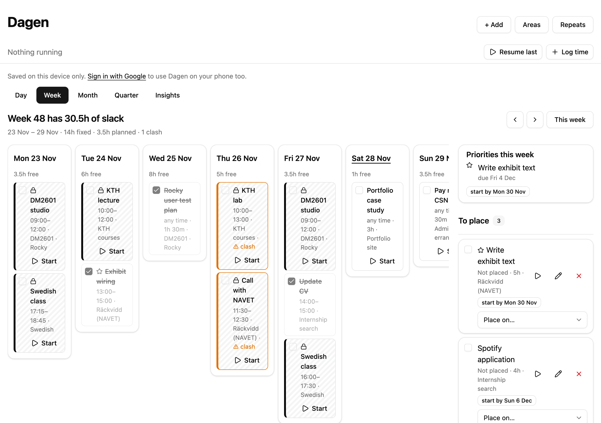
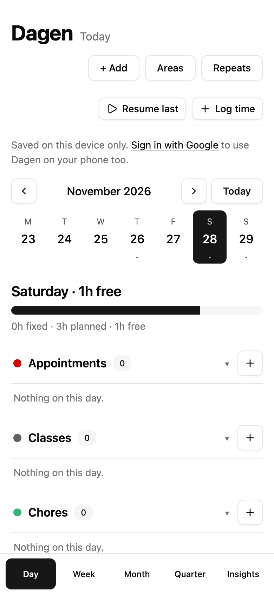
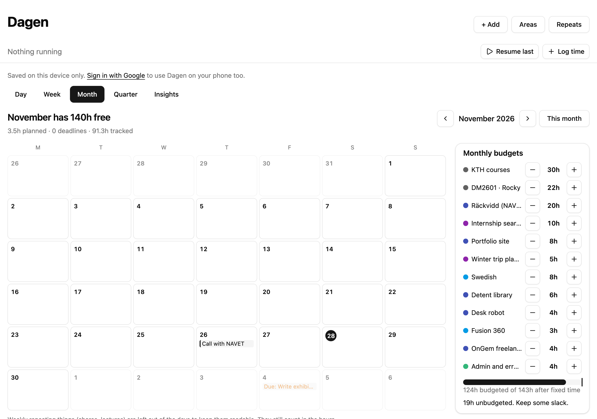
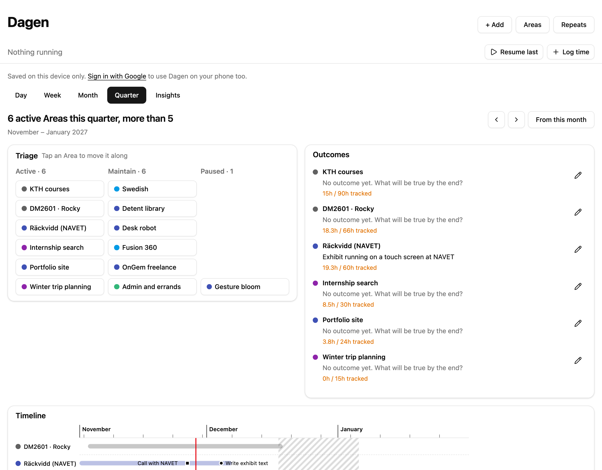
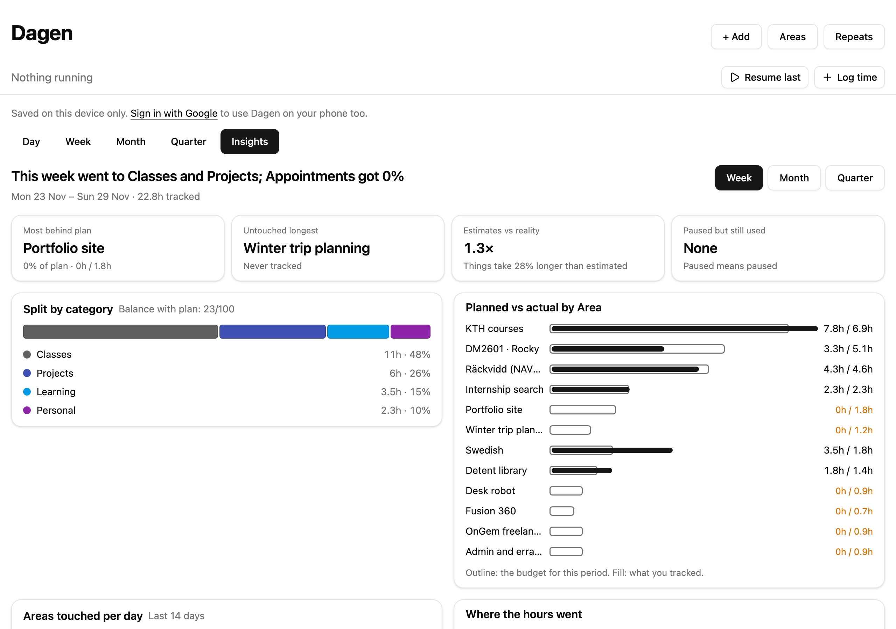

# Dagen

*Dagen* is Swedish for "the day". It's a phone-first planner (an installable web app) that works across four horizons, the day, the week, the month and the quarter, and tracks where your time actually goes.

**Status:** v3.0, "Dagen Horizon", is complete (Phases 0–17). The plan it was built from is in [`docs/horizon-spec.md`](docs/horizon-spec.md). The look is a plain shadcn/ui base for now; the design comes later.

| Week | Day (phone) |
|---|---|
|  |  |

| Month | Quarter | Insights |
|---|---|---|
|  |  |  |

## What it does

**Hard things first, soft things fill what's left.** Fixed events (and lectures from your busy Google calendars) take a day's capacity first. Flexible tasks use what remains, and Dagen tells you when a day is overpacked.

- **Day:** a headline that states the finding ("Friday · 3h free" or "Friday is overpacked by 0.5h"), a fixed / planned / free bar, tasks by category, and the day's time log.
- **Week:** the main planning screen. It has seven days, this week's priorities, and **To place**, for tasks without a day. Deadlines turn into "start by" pills. On a computer you can drag tasks between days.
- **Month:** a calendar of deadlines and one-off events, plus each Area's monthly hour budget, checked against the time the month really has.
- **Quarter:** triage your Areas into Active, Maintain and Paused. There's also a three-month timeline (with labels that never overlap) and each Area's goal for the quarter.
- **Insights:** planned against tracked, for the week, month or quarter. It shows what's most behind, what's untouched, how good your estimates are, and where the hours went.
- **Areas:** each thing you're involved in (a course, a project, the job search) has a status and a monthly budget. The 8 categories still set the colours, and Google Calendar uses them too.
- **Three kinds of item:**
  - fixed events, which happen at a set time
  - tasks with a deadline, which get a start-by day
  - open tasks, with no date at all
- **One timer:** starting a task stops the one before. Every stop saves an entry, and anything under a minute is thrown away. You can also log time by hand, or mark a past block "as planned" in one tap.
- **Rollover, with your say-so:** each morning Dagen asks whether yesterday's unfinished tasks should go back to To place, and counts how often each one was pushed. At 3 pushes it offers *Halve it* or *Drop*.
- **Away time:** days on a trip have no capacity.
- **Everywhere:**
  - Undo after every delete.
  - The `N` key opens one Add form.
  - Copy or import the whole planner as JSON.
  - It's installable as a PWA, and works at 360px wide.
- **Sync:** Google sign-in, cloud save (Supabase), and two-way Google Calendar sync for timed tasks.

## Run it locally

    npm install
    npm run dev

Then open http://localhost:5173.

To try it with realistic sample data (RK's Areas, a week of classes, a trip and about 40 days of tracked time), open **http://localhost:5173/?seed=horizon**. This only works in development, and it replaces what's saved on that device.

`npm run check` runs lint, the tests and the build, the same as CI.

## Built with

React 19, Vite, Tailwind CSS with shadcn/ui, Supabase, the Google Calendar API, and Vitest with Testing Library. The rules live in plain, tested functions in `src/lib/`; the components draw them.

## Roadmap

- [x] Phase 0: Setup, GitHub and Vercel
- [x] Phase 1: Task list
- [x] Phase 2: Automated checks (GitHub Actions)
- [x] Phase 3: Categories and colours
- [x] Phase 4: The + create flow
- [x] Phase 5: Week strip and task actions
- [x] Phase 6: Recurring chores (v1.0)
- [x] Phase 7: Cloud and login
- [x] Phase 8: Push to Google Calendar
- [x] Phase 9: Two-way sync and busy calendars (v2.0)
- [x] Phase 10: Blueprint look with drawably
- [x] Plain shadcn/ui look in place of drawably, for now (the design comes later)

### Dagen Horizon (v3.0)

- [x] Phase 11: Data model, Areas, unplaced tasks (v2.1)
- [x] Phase 12: Week view, To place, rollover, deadlines (v2.2)
- [x] Phase 13: Timer and time log (v2.3)
- [x] Phase 14: Month view and budgets (v2.4)
- [x] Phase 15: Quarter view and away blocks (v2.5)
- [x] Phase 16: Insights (v2.6)
- [x] Phase 17: Polish and release (v3.0)

### Later

- A designed look, built on the shadcn/ui base
- Time entries in a separate "Dagen log" Google calendar
- A timed grid for the Week view (drop a task at a time)
- AI suggestions for the week

See [`docs/build-log.md`](docs/build-log.md) for how it went.
